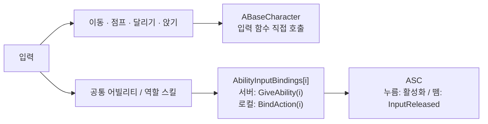
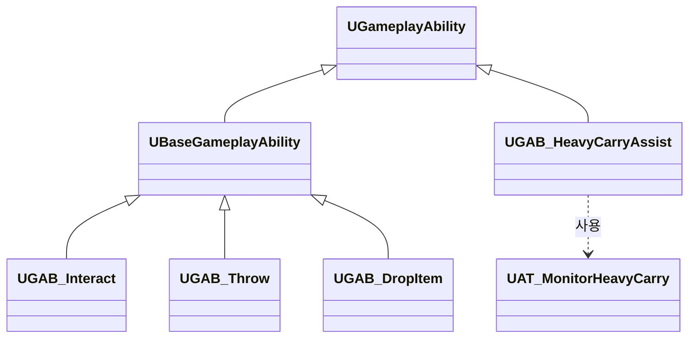
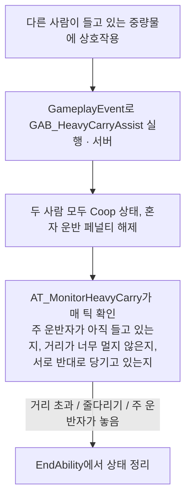

# Sneakers — 플레이어 · GAS 담당 코드

2~4인 협동 잠입 게임 **Sneakers**(6인 팀 프로젝트)에서 제가 맡은 **플레이어 캐릭터와 GAS(Gameplay Ability System)** 코드를 모아 둔 저장소입니다.

> 팀 저장소에서 제가 작성한 C++ 코드만 옮겨 왔습니다. 에셋과 다른 팀원의 코드는 포함하지 않았기 때문에 이 저장소만으로는 빌드되지 않습니다.
> 원본 팀 저장소: [jisungin88/HeavyHanded](https://github.com/jisungin88/HeavyHanded)

- 플레이 영상: [Google Drive에서 보기](https://drive.google.com/file/d/1yVI5975dxXVhWLWtkb1xoaZE55ClySO_/view?usp=drive_link)

## 목차

- [프로젝트 개요](#프로젝트-개요)
- [담당 파트](#담당-파트)
- [코드 구성](#코드-구성)
- [주요 구현](#주요-구현)
  - [1. 입력과 어빌리티 구조](#1-입력과-어빌리티-구조)
  - [2. 운반 · 던지기 · 놓기](#2-운반--던지기--놓기)
  - [3. 중량물 2인 협동 운반](#3-중량물-2인-협동-운반)
  - [4. 상호작용과 부활](#4-상호작용과-부활)
  - [5. 달리기와 스태미나](#5-달리기와-스태미나)
- [역할 스킬 (블루프린트)](#역할-스킬-블루프린트)

## 프로젝트 개요

| 항목 | 내용 |
|---|---|
| 장르 | 2~4인 협동 잠입 (전투 없이 경비를 피해 노획물을 밴까지 운반) |
| 엔진 | Unreal Engine 5.4, C++ / Blueprint |
| 네트워크 | Listen Server, Replication, RPC |
| 기간 | 2026.08 ~ 2026.10 |
| 인원 | 6인 팀 프로젝트 |
| 협업 도구 | Notion, Discord, Git, Sourcetree, Blender |

## 담당 파트

플레이어 캐릭터와 GAS 기반 스킬 전반을 맡았습니다.

| 영역 | 내용 |
|---|---|
| 기본 동작 | 1인칭 이동, 점프, 달리기, 앉기, 스태미나 소모·고갈·회복, 운반·다운 중 행동 제한 |
| 공통 어빌리티 | 상호작용, 노획물 던지기·놓기, 다운된 동료 부활, 중량물 2인 협동 운반 |
| 역할 스킬 | Brute, Ghost, Mimic, Oracle의 액티브·패시브, 쿨다운 GE, GameplayCue 연출 (블루프린트) |

## 코드 구성

```
Source/HeavyHanded/
├─ Public|Private/Character/
│  ├─ BaseCharacter            플레이어 캐릭터: 입력, 운반 상태, 스태미나 (공동 작업)
│  ├─ BaseGameplayAbility      공통 어빌리티 베이스: 몽타주 재생과 종료 처리 (공동 작업)
│  ├─ BaseAttributeSet         Health, MovementSpeed, Stamina, MaxStamina
│  ├─ PlayerSessionState       ASC와 AttributeSet을 가진 PlayerState
│  └─ Ability/
│     ├─ GAB_Interact          상호작용, 부활 채널링
│     ├─ GAB_Throw             조준 후 던지기
│     ├─ GAB_DropItem          놓기
│     ├─ GAB_HeavyCarryAssist  중량물 협동 운반 보조
│     └─ AT_MonitorHeavyCarry  협동 운반 감시 AbilityTask
├─ Public|Private/Shared/ThrowMath   던지기 수식 (서버 발사와 클라이언트 궤적 표시가 공유)
└─ Public|Private/Interfaces/Interactable   즉발형 상호작용 인터페이스
```

`BaseCharacter`와 `BaseGameplayAbility`는 다른 팀원과 함께 작업한 파일이라 일부 코드(예: 경비 체포 관련)는 제가 작성하지 않았습니다. 나머지 파일은 대부분 제가 작성했습니다.

## 주요 구현

### 1. 입력과 어빌리티 구조

관련 파일: [BaseCharacter.h](Source/HeavyHanded/Public/Character/BaseCharacter.h), [BaseGameplayAbility.h](Source/HeavyHanded/Public/Character/BaseGameplayAbility.h)

- 이동처럼 연속으로 들어오는 입력은 어빌리티를 거치지 않고 캐릭터에서 바로 처리하고, 속도가 바뀌는 달리기와 앉기만 GameplayEffect로 적용했습니다.
- 스킬 입력은 `AbilityInputBindings` 배열 하나로 관리합니다. 배열 인덱스를 InputID로 써서 서버의 `GiveAbility`와 로컬의 입력 바인딩이 같은 번호를 사용합니다.
- 키를 뗄 때 `InputReleased`가 전달되도록 해서, 조준 후 던지기나 누르고 있는 동안 부활 같은 동작을 만들었습니다.
- 공통 어빌리티는 `UBaseGameplayAbility`를 상속한 C++ 클래스로 만들고, 블루프린트에서는 몽타주 같은 값만 지정합니다.





### 2. 운반 · 던지기 · 놓기

관련 파일: [BaseCharacter.h](Source/HeavyHanded/Public/Character/BaseCharacter.h), [GAB_Throw.h](Source/HeavyHanded/Public/Character/Ability/GAB_Throw.h), [ThrowMath.h](Source/HeavyHanded/Public/Shared/ThrowMath.h), [GAB_DropItem.cpp](Source/HeavyHanded/Private/Character/Ability/GAB_DropItem.cpp)

- 들고 있는 물건(`HeldActor`)을 복제하고, 서버와 `OnRep`이 같은 함수(`ApplyCarryState`)로 물리 끄기 → 부착 순서를 똑같이 밟도록 했습니다.
- 운반 상태(`EHeavyCarryState`: None / Solo / Coop)는 C++에서 정하고, AnimBP는 그 값을 읽어 일반 운반과 중량물 운반 포즈를 고릅니다.
- 던지기는 키를 누르고 있는 동안 몽타주의 `HoldStart` 구간에서 멈춰 궤적을 보여 주고, 키를 떼면 `HoldEnd`로 넘어가 노티파이 프레임에 실제로 던집니다.
- 던지기 수식은 `ThrowMath`에 모았습니다. 서버의 실제 발사와 클라이언트의 궤적 표시가 같은 계산을 써야 미리 보인 궤적과 실제 경로가 어긋나지 않기 때문입니다.
- 방금 던진 물건은 짧은 시간 동안 던진 본인이 다시 잡지 못하게 해서, 던지고 바로 잡는 방식으로 중량물 규칙을 우회하는 것을 막았습니다.

### 3. 중량물 2인 협동 운반

관련 파일: [GAB_HeavyCarryAssist.h](Source/HeavyHanded/Public/Character/Ability/GAB_HeavyCarryAssist.h) / [.cpp](Source/HeavyHanded/Private/Character/Ability/GAB_HeavyCarryAssist.cpp), [AT_MonitorHeavyCarry.h](Source/HeavyHanded/Public/Character/Ability/AT_MonitorHeavyCarry.h) / [.cpp](Source/HeavyHanded/Private/Character/Ability/AT_MonitorHeavyCarry.cpp)



- 상호작용 어빌리티는 이벤트만 보내고, 보조 로직은 입력으로 직접 누를 수 없는 별도 어빌리티가 맡도록 나눴습니다.
- 두 사람의 이동 입력 방향이 반대인 상태가 이어지면 텐션이 쌓이고, 기준을 넘으면 보조자가 밀려나며 협동이 풀립니다. 실제 이동이 아니라 입력 방향으로 판정해서, 벽에 막혀 있어도 반대로 당기는 의도에 바로 반응합니다.
- 주 운반자가 물건을 놓으면 `Event.Loot.Dropped`로 바로 알려서, 다음 틱을 기다리지 않고 정리합니다.
- 종료 경로가 여러 개(거리 초과, 넉백, 주 운반자 해제, 강제 취소)라서 정리는 `EndAbility` 한 곳으로 모으고, 가드 플래그로 한 번만 실행되게 했습니다. 두 번 실행되면 혼자 운반 페널티가 이중으로 적용될 수 있기 때문입니다.

### 4. 상호작용과 부활

관련 파일: [GAB_Interact.h](Source/HeavyHanded/Public/Character/Ability/GAB_Interact.h) / [.cpp](Source/HeavyHanded/Private/Character/Ability/GAB_Interact.cpp), [Interactable.h](Source/HeavyHanded/Public/Interfaces/Interactable.h)

- 시선 방향으로 구체 스윕을 해서 대상을 찾고, 대상 종류(노획물, 중량물, 다운된 동료, `IInteractable` 구현체)에 따라 분기합니다.
- 문이나 상자처럼 즉시 끝나는 상호작용은 `IInteractable` 인터페이스로 분리했습니다. `BlueprintNativeEvent`라서 다른 팀원이 블루프린트로도 구현할 수 있습니다.
- 다운된 동료 부활은 키를 누르고 있는 동안 진행되는 채널링입니다. 정상 완료, 거리 이탈, 키 해제, 서버 취소 등 모든 종료를 `EndReviveChannel` 한 곳으로 모아 포즈가 풀리지 않는 사고를 막았습니다.

### 5. 달리기와 스태미나

관련 파일: [BaseAttributeSet.h](Source/HeavyHanded/Public/Character/BaseAttributeSet.h) / [.cpp](Source/HeavyHanded/Private/Character/BaseAttributeSet.cpp), [BaseCharacter.cpp](Source/HeavyHanded/Private/Character/BaseCharacter.cpp)

- 달리기는 `State.Sprinting` 태그를 붙이는 GE로 처리하고, 태그 변화를 구독해 달리는 동안 소음을 주기적으로 발생시킵니다.
- 스태미나는 달리는 동안 별도 GE로 소모되고, 0이 되면 `State.Exhausted`를 붙여 잠시 달리기를 막은 뒤 회복합니다.
- `PreAttributeChange`와 `PostGameplayEffectExecute` 양쪽에서 스태미나를 `[0, MaxStamina]`로 묶습니다. 주기형 GE는 BaseValue를 직접 바꾸기 때문에 `PreAttributeChange`만으로는 범위가 보장되지 않습니다.

## 역할 스킬 (블루프린트)

역할 스킬은 블루프린트 GA로 만들어서 이 저장소에는 코드가 없습니다. 자세한 내용은 플레이 영상과 포트폴리오 문서에서 볼 수 있습니다.

| 역할 | 패시브 | 액티브 |
|---|---|---|
| Brute | 중량물 속도 페널티 감소 | 돌진, 동료 투척 |
| Ghost | 이동 속도 증가 | 그림자 이동, 시간 늦추기 |
| Mimic | 달려도 발소리 없음 | 경비 변장 |
| Oracle | 노획물 정보 표시 | 경비 시야 표시 |

- **그림자 이동:** `State.ShadowStep` 태그를 붙여 압력판, 레이저, 보안 카메라 판정에서 빠지고, GameplayCue로 캐릭터를 반투명(DitherFade)하게 바꾸며 본인 화면의 채도를 낮춥니다.
- **경비 변장:** 변장 태그를 가진 플레이어를 경비의 시야와 청각 감지가 무시하고, 메시 교체는 멀티캐스트로 모든 화면에 반영됩니다. 20초가 지나거나 체포되면 풀립니다.
